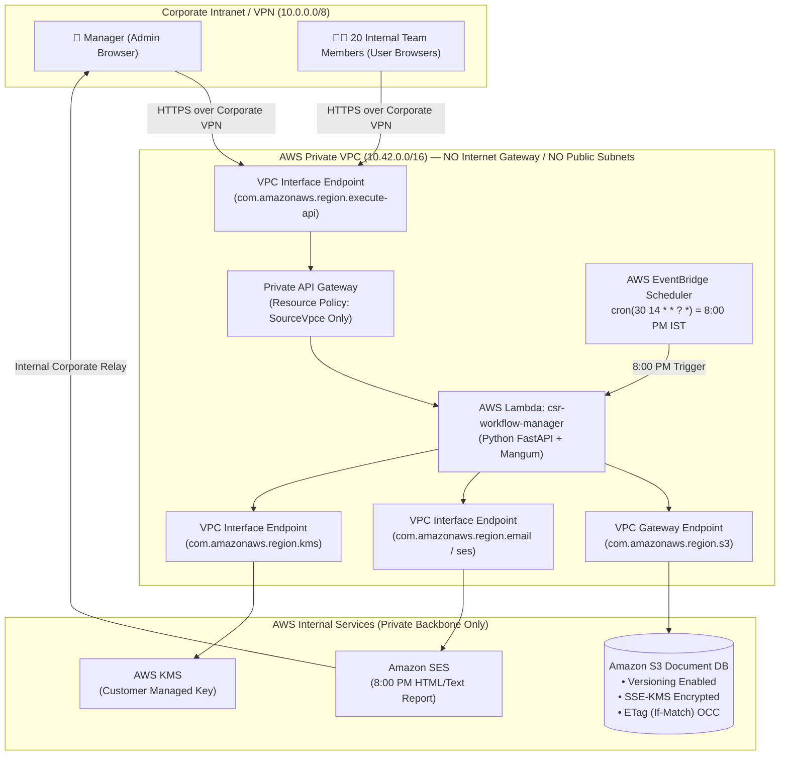
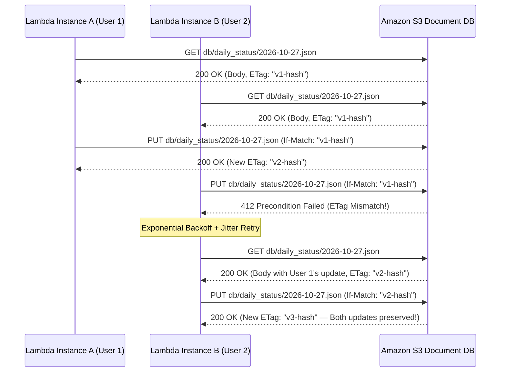
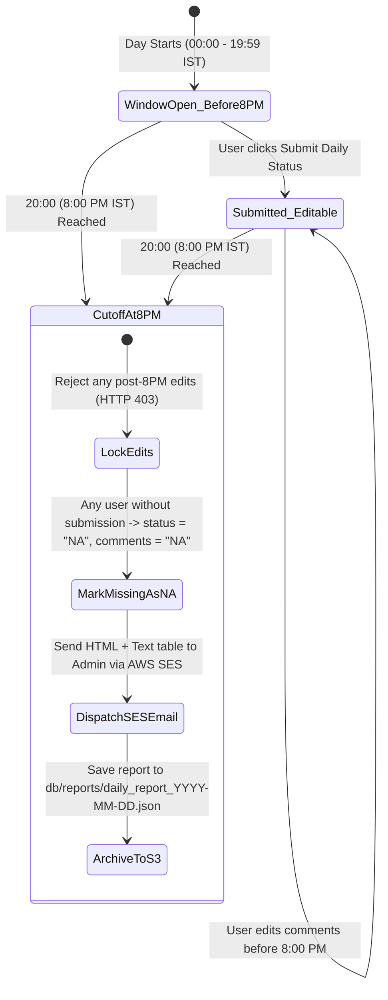

# CSR Work Flow Manager — System Design & Zero-Internet-Exposure Security Architecture

## 1. Executive Summary & Requirements Alignment

**CSR Work Flow Manager** is an internal Jira-grade task management, design workflow, and automated **8:00 PM Daily Status** platform engineered for an internal 20-member team. It is deployed serverlessly on **AWS Lambda** and uses **Amazon S3 as a Document Database** inside a **Private AWS VPC** with **zero exposure to the public internet**.

| Requirement | Architectural Solution Implemented |
| :--- | :--- |
| **Main Page & Branding** | Dedicated **CSR Work Flow Manager** landing & system posture dashboard displaying live IST server time, 8:00 PM cutoff countdown, Private VPC status, and role-based login (`ADMIN` vs `USER`). |
| **Admin (Manager) Role** | Full CRUD for up to 25 team members (`Add`, `Edit`, `Deactivate`, `Delete`), assign Design & CSR tasks, extend task timelines with mandatory reason & history tracking, add manager comments, view all user comments, and receive/trigger the 8:00 PM email report. |
| **User (Team Member) Role** | View assigned tasks & sprint board, track deadlines & timeline extensions, update task statuses, log hours, post `BLOCKER` or `REMARK` comments on tasks, and submit/edit daily status comments before 8:00 PM. |
| **8:00 PM Daily Status Cutoff & `NA` Email** | Users can freely submit and re-edit their daily status before **8:00 PM (20:00 IST)**. At 8:00 PM, editing is locked (`HTTP 403`) and **AWS EventBridge** triggers Lambda to mark any unsubmitted active user as **`NA`** and dispatch an HTML + Plaintext table via **AWS SES** to Admin(s). |
| **S3 as Document DB** | Partitioned JSON document store on Amazon S3 (`db/users.json`, `db/tasks.json`, `db/sprints.json`, `db/daily_status/{YYYY-MM-DD}.json`, `db/reports/...`, `db/audit/...`) using **S3 `ETag` (`If-Match`) Optimistic Concurrency Control (OCC)** with exponential backoff retries. |
| **Zero Internet Exposure** | Private API Gateway (`PRIVATE` endpoint), VPC-attached Lambda in isolated private subnets (no IGW/NAT), S3 VPC Gateway Endpoint, SES/KMS VPC Interface Endpoints, S3 Bucket Policy denying any request outside `aws:SourceVpce`, and zero external CDN assets in the frontend. |

---

## 2. High-Level System Architecture (Private VPC / Zero Internet Exposure)



---

## 3. S3 Document Database Design & Concurrency Control

Amazon S3 provides **strong read-after-write consistency** for all `PUT` and `GET` operations. For an internal team of 20 members, storing structured collections as partitioned JSON documents in S3 eliminates database server maintenance while keeping monthly storage costs under `$0.10/month`.

### 3.1 S3 Object Key Partitioning Layout

```text
s3://csr-workflow-docdb-<account-id>-<region>/
├── db/
│   ├── users.json                          # 20+ User profiles, roles (ADMIN/USER), PBKDF2 password hashes
│   ├── sprints.json                        # Sprint definitions, goals, and start/end dates
│   ├── tasks.json                          # Tasks, Design Tasks, Timeline Extension History, Task Comments
│   ├── daily_status/
│   │   ├── 2026-10-26.json                 # Partitioned by date: all 20 users' daily submissions + lock flag
│   │   └── 2026-10-27.json
│   ├── reports/
│   │   └── daily_report_2026-10-27.json    # Archived 8:00 PM HTML/Text email report & SES MessageId
│   └── audit/
│       └── 2026-10-27.json                 # Date-partitioned immutable security & workflow audit log
```

### 3.2 Optimistic Concurrency Control (OCC) via S3 `ETag` (`If-Match`)

To prevent lost updates when two team members submit their daily status or comment on a task at the same millisecond across concurrent Lambda containers, [`S3DocumentDB`](file:///c:/Users/Administrator/Desktop/JIRA/backend/s3_db.py) implements atomic compare-and-swap using S3's native conditional write headers:



---

## 4. 8:00 PM Daily Status Cutoff & `NA` Email Workflow



1. **Before 8:00 PM (`00:00` – `19:59:59 IST`)**:
   - Users can submit their daily tasks (`tasks_worked_on`, `accomplishments`, `planned_next`, `blockers_remarks`, `hours_logged`) via `POST /api/daily-status/submit`.
   - Users can re-edit and update their submission as many times as needed before 8:00 PM (`edit_count` increments on each save).
2. **At & After 8:00 PM (`20:00:00 IST`)**:
   - Application-level guard [`is_daily_status_editable()`](file:///c:/Users/Administrator/Desktop/JIRA/backend/config.py) immediately blocks any create/edit request with `403 Forbidden`.
   - **AWS EventBridge Rule** (`cron(30 14 * * ? *)`, which is `20:00 IST`) invokes [`lambda_handler`](file:///c:/Users/Administrator/Desktop/JIRA/backend/app.py).
   - [`execute_8pm_daily_cutoff_and_email()`](file:///c:/Users/Administrator/Desktop/JIRA/backend/scheduler.py) iterates through all active users in `db/users.json`:
     - Users who submitted keep their comments and are locked (`locked: true`).
     - Users who **did not submit** before 8:00 PM are written with `status: "NA"`, `accomplishments: "NA"`, `planned_next: "NA"`, `blockers_remarks: "NA"`.
   - [`send_daily_status_email()`](file:///c:/Users/Administrator/Desktop/JIRA/backend/email_service.py) sends the formatted HTML + Plaintext email to Admin(s) via AWS SES and archives the report in `db/reports/daily_report_{YYYY-MM-DD}.json`.

---

## 5. Defense-in-Depth Security Controls ("No Exposing of Information to Internet")

1. **Network Layer Isolation**:
   - **No Public IP / No IGW**: Lambda runs inside private subnets (`10.42.1.0/24`, `10.42.2.0/24`) with no Internet Gateway and no NAT Gateway.
   - **Private API Gateway**: Configured with `EndpointConfiguration: PRIVATE` and a strict Resource Policy denying any invocation where `aws:SourceVpce != vpce-<execute-api>`.
   - **S3 Bucket Policy**: Explicitly denies `s3:*` if `aws:SecureTransport == false` (enforces TLS 1.2+) or if `aws:SourceVpce != vpce-<s3-gateway>`. All four `PublicAccessBlock` flags are `true`.
2. **Authentication & Authorization (RBAC)**:
   - **Password Hashing**: Salted `PBKDF2-HMAC-SHA256` with `600,000` iterations and constant-time digest verification (`hmac.compare_digest`).
   - **Session Tokens**: Signed `HS256` JWTs transmitted via `HttpOnly; SameSite=Strict` cookies and `Authorization: Bearer` headers.
   - **Strict Role Enforcement**: Every Admin endpoint (`POST/PUT/DELETE /api/users`, `POST /api/tasks`, `POST /api/tasks/{id}/extend-timeline`, `POST /api/daily-status/trigger-8pm-report`) enforces the `require_admin` dependency.
3. **Browser & Air-Gapped Content Security**:
   - The frontend SPA (`frontend/index.html`, `frontend/styles.css`, `frontend/app.js`) is 100% self-contained with **zero external CDN scripts, fonts, or stylesheets**.
   - Every HTTP response enforces `Content-Security-Policy: default-src 'self'...`, `X-Frame-Options: DENY`, `X-Content-Type-Options: nosniff`, `Referrer-Policy: no-referrer`, and `Cache-Control: no-store`.
